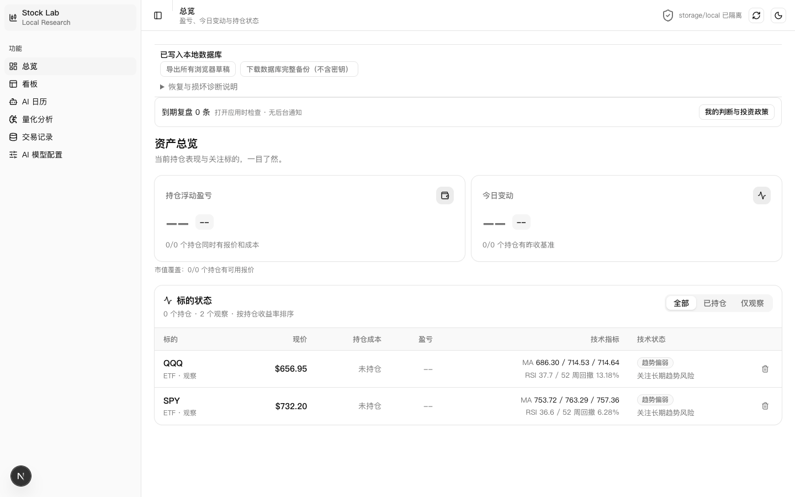
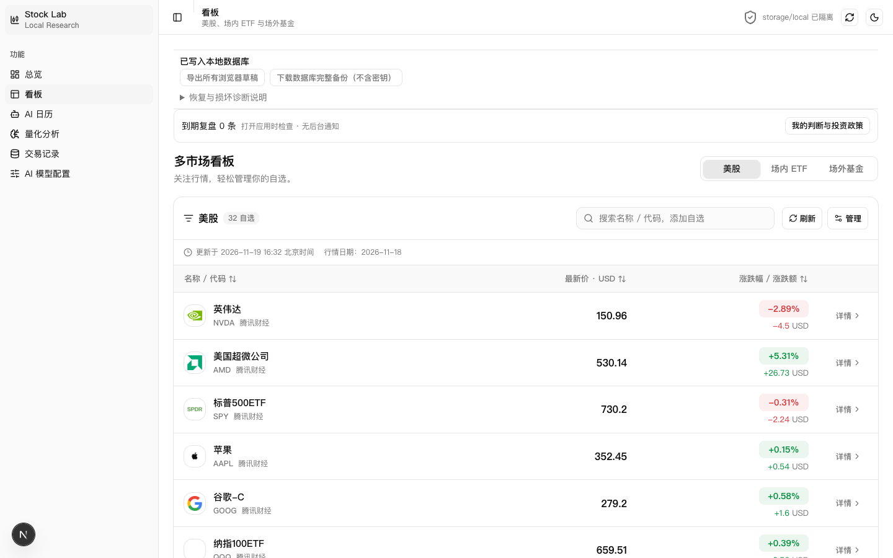
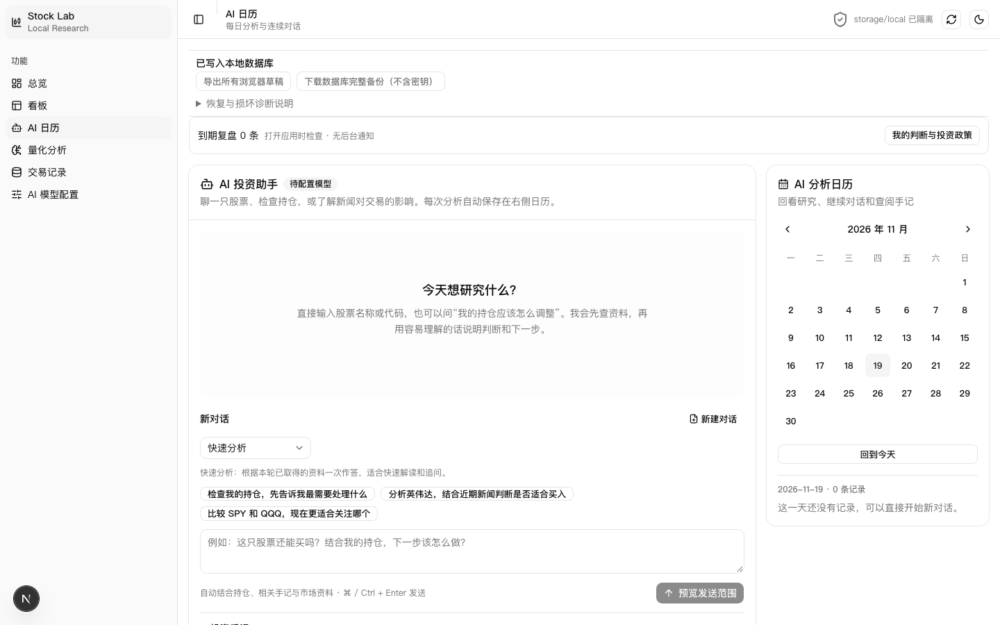
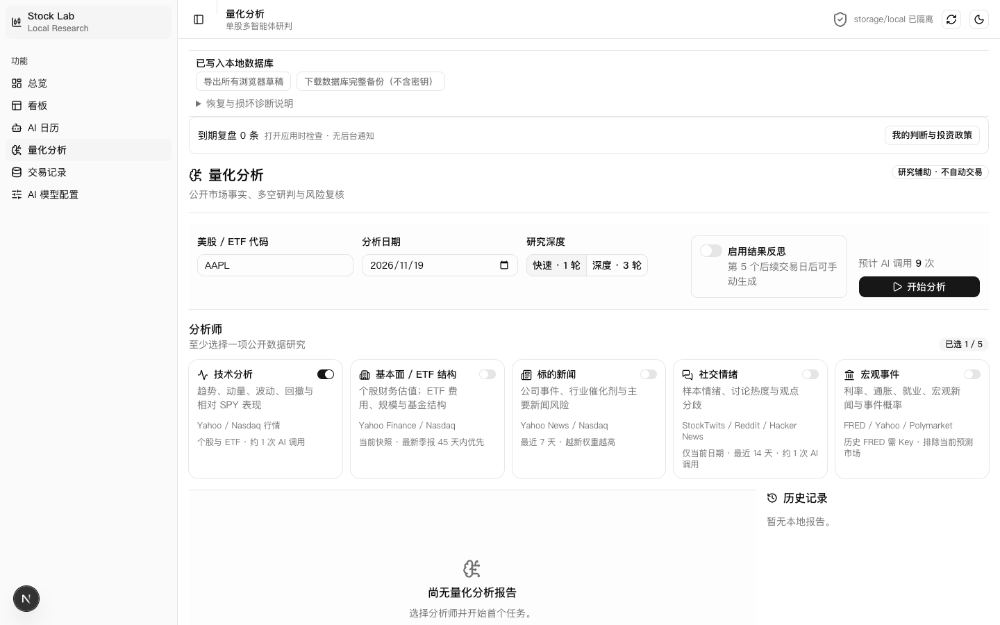
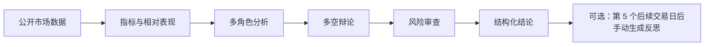
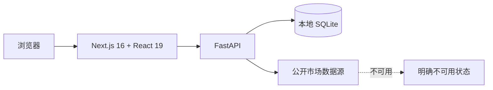

<a id="中文"></a>

<h1 align="center">持仓手记 · 量化分析</h1>

<p align="center">
  <strong>把投资研究和决策过程，留在自己的工作台。</strong><br>
  持仓 · 行情 · AI 研究 · 交易复盘
</p>

<p align="center">
  <a href="https://github.com/maoqiu77/us-stock-dca-journal/releases"></a>
  <a href="LICENSE"></a>
  
  
  
  
</p>

<p align="center">
  <a href="#中文">中文</a> · <a href="#english">English</a>
  <br>
  <a href="#产品界面">界面预览</a> · <a href="#核心能力">功能介绍</a> · <a href="#下载与运行">下载安装</a> · <a href="#隐私与数据边界">隐私</a> · <a href="#开发指南">开发指南</a>
</p>

---

这是一款面向美股个股与 ETF 的本地投资研究和交易复盘工具。从观察市场、记录持仓，到提出问题、保存判断，每一步都可以在同一个工作台完成。

<p align="center">
  <a href="docs/screenshots/overview.png"></a>
</p>
<p align="center"><sub>桌面工作台 · 总览、市场看板、AI 日历和量化分析</sub></p>

> [!NOTE]
> 本 README 描述 `main` 分支的源码现状。发布版界面与功能可能不同；`v1.3.2-rc.1` 是源码候选，不是一键安装包。

> [!WARNING]
> 本项目用于研究与复盘，不连接券商账户执行交易，也不会自动下单。量化结果与 AI 内容不构成投资建议。

## 核心能力

| 观察与记录 | 研究与复盘 |
| --- | --- |
| **📊 资产总览**<br>查看持仓成本、盈亏、今日变动与技术状态。 | **✨ AI 投资助手**<br>围绕持仓、标的与新闻提问，发送前预览资料范围。 |
| **📈 多市场看板**<br>管理美股、场内 ETF 和场外基金自选，查看来源与行情。 | **🧠 量化分析**<br>结合公开数据、多角色研判和风险复核生成研究报告。 |
| **🧾 交易记录**<br>录入交易流水或导入持仓截图，维护成本和目标仓位。 | **🗓️ AI 日历与复盘**<br>按日期回看研究、追问、手记和投资判断。 |

私有运行数据默认存放在本机；公开行情不可用时，页面显示明确的不可用状态或带原始观察时间的真实缓存。示例数据仅用于显式开发或测试。

## 产品界面

截图来自当前主线，使用隔离的空账本和默认自选。行情是截图时的公开数据，可能变化或不可用。

<table>
  <tr>
    <td width="50%"><strong>多市场看板</strong><br><sub>自选、行情与数据来源集中查看</sub></td>
    <td width="50%"><strong>AI 日历</strong><br><sub>研究、对话和手记按日期回看</sub></td>
  </tr>
  <tr>
    <td><a href="docs/screenshots/market-board.png"></a></td>
    <td><a href="docs/screenshots/ai-calendar.png"></a></td>
  </tr>
</table>

**量化分析** · 选择研究深度和分析师，查看多角色研判与历史报告。可选的结果反思在第 5 个后续交易日后手动生成。

[](docs/screenshots/quant-analysis.png)

## 从观察到复盘

1. **建立观察清单**：在总览和看板中查看标的、行情与技术状态。
2. **记录自己的决策**：维护持仓、交易和投资政策；截图导入需要支持图片的模型。
3. **开展研究**：在 AI 日历提问并预览发送范围，或使用量化分析研究公开市场信息。
4. **回看与调整**：按日期查阅研究、对话和手记，结合到期复盘重新检查判断。

## 下载与运行

前往 [Releases](https://github.com/maoqiu77/us-stock-dca-journal/releases) 下载当前候选或稳定版。当前候选源码包可直接下载：[v1.3.2-rc.1 源码归档](https://github.com/maoqiu77/us-stock-dca-journal/releases/download/v1.3.2-rc.1/stock-trading-platform-next-v1.3.2-rc.1.zip)。该包用于源码审查和本地开发，不是一键运行包；请不要把 GitHub 自动生成的 `Source code (zip)` 当作安装包。

| 系统 | v1.3.2 安装包 | 启动方式 |
| --- | --- | --- |
| Windows x64 | `stock-trading-platform-next-v1.3.2-windows-x64.zip` | 双击 `启动股票交易平台.exe` |
| macOS Apple 芯片 | `stock-trading-platform-next-v1.3.2-macos-arm64.zip` | 双击 `启动股票交易平台.command` |
| macOS Intel | `stock-trading-platform-next-v1.3.2-macos-x64.zip` | 双击 `启动股票交易平台.command` |

1. 下载与电脑匹配的压缩包并**完整解压**。
2. 双击启动文件，等待浏览器打开 <http://127.0.0.1:3000/>。
3. 使用期间保持控制台或终端窗口开启；关闭窗口会停止本地服务。

如果 macOS 首次阻止运行，请右键启动文件，选择“打开”，再确认一次。发布版仅在本机 `127.0.0.1:3000` 提供服务，不向局域网开放私有交易数据。

<details>
<summary><strong>查看版本说明</strong></summary>

- **v1.3.2 稳定版**：提供 Windows 和 macOS 运行包；包含应用内版本检查、更新前备份与安装包校验。
- **v1.3.2-rc.1 源码候选**：用于审查和本地开发，不包含私有运行数据，也不替代安装包的签名、公证和真机验收。
- 更早版本的改动和下载文件见 [Releases](https://github.com/maoqiu77/us-stock-dca-journal/releases)。

</details>

## 隐私与数据边界

> [!IMPORTANT]
> 私有运行数据默认写入 `storage/local/`，该目录已被 Git 忽略。公开示例位于 `storage/templates/`。备份、截图或提交代码前，仍应确认其中不含真实账户信息、交易流水、券商导出文件、API Key、Cookie 或数据库。

| 数据类型 | 默认位置 | 是否可提交 |
| --- | --- | --- |
| 示例自选股、虚构评测数据 | `storage/templates/` | 可以，但必须是合成数据 |
| 账户、持仓、交易流水、AI 记录 | `storage/local/app.db` | **不可以** |
| AI / FRED Key 与本地设置 | `storage/local/` | **不可以** |
| 量化报告、运行阶段与反思 | `storage/local/quant-analysis/`、本地 SQLite | **不可以** |

AI 建议与量化分析遵循不同的数据范围：

- **AI 建议**可以在用户确认后发送账户、持仓、交易与策略上下文到用户选择的 AI 服务商。
- **量化分析**只发送标的代码、公开市场数据和公开新闻摘要，不发送账户余额、持仓、现金或交易流水。
- 合成 fixture 只用于显式开发/测试注入，不作为生产行情或 AI 事实依据。

## AI 连接设置

在「AI 模型配置」中先选择服务商，再输入 API 密钥。支持第三方 API、DeepSeek、Kimi、GLM、OpenAI、Claude、通义千问、MiniMax 和硅基流动。官方预设使用普通 API 地址和默认模型，通常只需填密钥；国内平台预设使用中国区地址，其他地区或专用套餐请使用第三方配置。

「高级设置」可更换复杂／简单任务模型及受支持的协议。第三方支持自动检测、Chat Completions、Responses 和 Anthropic Messages；测试连接成功后，返回的模型列表也会加入模型输入框建议。未知模型可手动输入，实际可用性以服务商和连接测试为准。

每个服务商的配置和密钥分别保存在本机，旧配置自动归入第三方 API。切换服务商不会混用密钥；更换第三方地址后需重新输入密钥。识别持仓截图需要支持图片的简单任务模型，文字连接测试不验证图片能力。

## 量化分析

量化分析支持 Yahoo 可识别的美国个股和 ETF，并明确分开“可复算事实”和“非确定性研判”。



可复算层包括均线、RSI、MACD、布林带、ATR、VWMA、回撤和相对 SPY 收益。AI 层可以组合技术面、基本面或 ETF 结构、新闻、社交情绪和宏观事件，再经过多空讨论与风险评估形成研究结论。

历史分析不会混入当前基本面快照、当前社交情绪或当前 Polymarket 数据。配置 FRED Key 时，宏观序列会固定到分析日期对应的数据 vintage。快速模式通常需要“分析师数量 + 8”次 AI 调用，深度模式通常需要“分析师数量 + 18”次；结构化 JSON 修复可能额外调用一次。

多角色研究流程参考了 [TauricResearch/TradingAgents](https://github.com/TauricResearch/TradingAgents) 的角色分工与研究辩论思路。本项目没有安装或打包 TradingAgents，而是在 Next.js + FastAPI 架构和本地隐私边界内独立实现。详见 [第三方说明](THIRD_PARTY_NOTICES.md)。

## 技术架构



| 目录 | 职责 |
| --- | --- |
| `apps/web` | Next.js、React、shadcn/ui、TanStack Query 与 Lightweight Charts |
| `apps/api` | FastAPI、本地数据、行情适配、指标、回测与 AI 工作流 |
| `storage/templates` | 可公开的合成示例和配置模板 |
| `storage/local` | 被 Git 忽略的私有运行数据 |
| `apps/miniprogram` | 开发中的微信小程序，发布与真机验收状态见其文档 |
| `packages` | 桌面端与小程序使用的共享领域、上下文和行情代码 |
| `stock_rotation_v1` | 独立的股票轮动研究与回测原型，不接入桌面交易流程 |
| `scripts` | 启动、迁移、发布与公开安全检查 |

## 开发指南

开发环境需要 **Python 3.12+** 和 **Node.js 24**。桌面运行分为两种模式：基础模式提供本地账本、行情缓存、备份恢复和 Web 工作台；可选 Agent 模式另需 Python 3.12 与 `apps/api/requirements-agent.lock`，仅在完整依赖环境中承诺 Agent 测试。发行包当前声明 `runtimeMode: base`，不会把 Agent 依赖悄悄打进基础包。

| 能力 | 基础模式 | Agent 模式 |
| --- | --- | --- |
| Web / 本地 FastAPI / 合成离线备份恢复 | 支持 | 支持 |
| 公开行情 | 真实观察、真实缓存或不可用 | 同左 |
| AI Journal Agent 工具执行 | 不启用 | 需本地模型配置和锁定依赖；本地测试不调用模型 |

基础 API 测试使用隔离临时数据目录：`npm run test:api:base`；完整 Agent 环境使用 `npm run test:api:agent`。后者若有任何跳过测试会失败。安装和恢复演练见 [U02 备份恢复说明](优化/U02_备份恢复说明.md)。

```bash
npm ci
npm run setup:api
```

分别启动 API 和网页端：

```bash
npm run dev:api
npm run dev:web
```

`setup:api` 使用 `python3.12` 创建 `storage/local/base-dev-venv`，与 `dev:api` 使用的路径一致。网页端默认位于 <http://127.0.0.1:3000/>，API 默认位于 <http://127.0.0.1:8000/>。本仓库的 `一键打开股票交易平台.command` 使用单独的 Agent 环境；准备方法见 [Agent 运行环境](docs/implementation/ai-journal-agent/RUNTIME_PY312.md)。提交前运行完整检查：

```bash
npm run check
```

离线 AI 投资上下文评测包含 20 个虚构案例，使用方式见 [评测指南](docs/ai-context-evaluation.md)。参与开发前请阅读 [贡献指南](CONTRIBUTING.md)；安全问题请按照 [安全策略](SECURITY.md) 私密报告。

## 其他项目与研究原型

- **微信小程序**：源码位于 `apps/miniprogram`，包含本地持仓、个人手记和备份恢复；云端 AI 与行情依赖独立配置。尚未完成上线验收，参见 [小程序说明](docs/miniprogram/README.md) 和 [验收记录](docs/implementation/chicang-slim/ACCEPTANCE.md)。
- **股票轮动回测 V1**：[研究说明](stock_rotation_v1/README.md) 包含运行方法、数据口径、成本与偏差。它是独立研究脚本，不会自动下单，也不保证回撤上限。

## 维护与许可

本仓库由 [@maoqiu77](https://github.com/maoqiu77) 创建并主要维护，基于 [Apache License 2.0](LICENSE) 开源。

---

<a id="english"></a>

# Chicang Shouji + Quant Analysis

> A local-first workspace for US stock and ETF research, portfolio journaling, strategy review, and AI-assisted analysis.

[中文](#中文) | [English](#english)

The desktop workspace combines portfolio status, market watchlists, trade records, an AI journal, and multi-role quantitative research. The repository also contains an in-development WeChat mini program and a standalone stock rotation backtest. It does not place trades. The main branch may differ from published releases.

## Highlights

- **One workspace:** portfolio overview, multi-market board, AI calendar, and multi-agent quantitative analysis.
- **Reproducible first:** indicators and relative performance are calculated before non-deterministic AI interpretation.
- **Decisions with history:** trades, daily advice, and follow-up conversations are organized in a browsable calendar.
- **Local by default:** private runtime data and provider keys stay under the gitignored `storage/local/` directory.
- **Resilient UI:** production market paths show real observations, timestamped real caches, or an explicit unavailable state; synthetic data is limited to explicit development/test injection.

## Product interface

See the [screenshots above](#产品界面) for the current main-branch desktop interface. They use an isolated empty ledger and default watchlists; quotes are point-in-time public data.

> [!WARNING]
> This project is for research and journaling only. It never places trades, and its quantitative or AI-generated output is not investment advice.

## Download

Get the current candidate or a ready-to-run package from [GitHub Releases](https://github.com/maoqiu77/us-stock-dca-journal/releases). The current `v1.3.2-rc.1` candidate includes a [source archive](https://github.com/maoqiu77/us-stock-dca-journal/releases/download/v1.3.2-rc.1/stock-trading-platform-next-v1.3.2-rc.1.zip) for review and local development. It is not a one-click installer.

| Platform | v1.3.2 package |
| --- | --- |
| Windows x64 | `stock-trading-platform-next-v1.3.2-windows-x64.zip` |
| macOS Apple Silicon | `stock-trading-platform-next-v1.3.2-macos-arm64.zip` |
| macOS Intel | `stock-trading-platform-next-v1.3.2-macos-x64.zip` |

Extract the archive, then open `启动股票交易平台.exe` on Windows or `启动股票交易平台.command` on macOS. Keep the terminal window open while using the app. The browser will open at <http://127.0.0.1:3000/>.

Do not use GitHub's automatically generated `Source code (zip)` archive unless you intend to set up a development environment.

## Privacy model

Public synthetic examples live in `storage/templates/` and are never an automatic production fallback. Accounts, positions, trades, AI conversations, provider keys, research reports, and local databases belong in `storage/local/` and must never be committed.

Daily AI advice may send private investment context only after explicit confirmation. Quant Analysis sends public symbol, market, and news data only; it never sends balances, positions, cash, or trade history. Synthetic fixture data is not a production evidence source.

## Development

Python 3.12+ and Node.js 24 are required.

```bash
npm ci
npm run setup:api
npm run dev:api
npm run dev:web
```

`setup:api` requires `python3.12` and creates the environment used by `dev:api`. The optional journal Agent uses a separate environment; see [runtime setup](docs/implementation/ai-journal-agent/RUNTIME_PY312.md). The [mini program](docs/miniprogram/README.md) has not completed release acceptance. The [rotation backtest](stock_rotation_v1/README.md) is a separate research prototype.

Run `npm run check` before submitting a pull request. See [CONTRIBUTING.md](CONTRIBUTING.md), [SECURITY.md](SECURITY.md), and [THIRD_PARTY_NOTICES.md](THIRD_PARTY_NOTICES.md) for contribution, security, and attribution details.

Licensed under the [Apache License 2.0](LICENSE).
